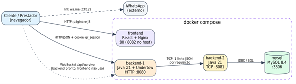
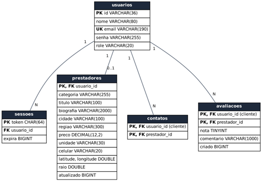
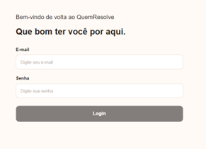
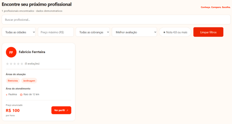
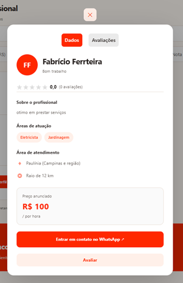
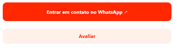
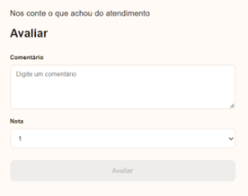
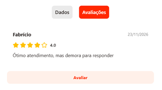
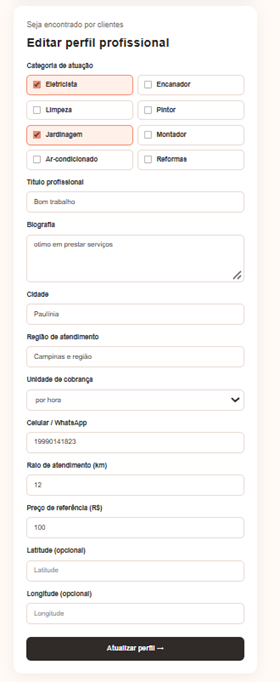

# QuemResolve — Documento de Projeto

**Projeto Integrador IV · PUC-Campinas · 2026-2 · Turma 0101 · Grupo 04**

---

# Capítulo 1. Visão geral

**Responsável:** Fabrício

## Problema

Quem precisa contratar um serviço local (eletricista, encanador, diarista, pintor) normalmente não sabe quais profissionais atendem sua região, quanto costumam cobrar nem como outros clientes avaliaram o trabalho. A busca acontece em indicações de conhecidos e anúncios sem padrão, o que é demorado e leva a escolhas feitas sem informação suficiente.

O prestador, por sua vez, depende do boca a boca para ser encontrado. O QuemResolve centraliza essas informações em uma aplicação web responsiva, sem assumir a negociação nem o pagamento.

## Público

- **Cliente:** cadastra-se, procura prestadores por categoria, cidade e preço, consulta perfil e avaliações, abre o contato pelo WhatsApp e avalia o profissional depois do atendimento.
- **Prestador:** cadastra-se, preenche e atualiza seu perfil profissional (categorias, região, valor de referência, celular) para ser encontrado.

## Escopo

O que o sistema entrega nesta versão (detalhe e situação de cada item no capítulo 3):

- **E1:** Cadastro e login de usuário (cliente ou prestador).
- **E2:** Cadastro do perfil profissional do prestador.
- **E3:** Pesquisa de prestadores por categoria, cidade, texto e preço máximo.
- **E4:** Lista de prestadores com cidade/região, categoria e nota média.
- **E5:** Perfil do prestador, com informações, valor e avaliações.
- **E6:** Avaliação do prestador pelo cliente, compondo a nota média.
- **E7:** Contato com o prestador por WhatsApp.
- **E8:** Atualização do perfil pelo prestador.
- **E9:** Interface web responsiva.
- **E10:** Canal WebSocket no Backend 1 (parcial: o frontend ainda não o consome).

## Fora do escopo

Aplicativo móvel nativo, pagamento, contratação ou fechamento do serviço dentro da plataforma, chat interno, agenda e disponibilidade, garantia ou fiscalização do serviço e entrega de produtos (todos já previstos na Entrega 1).

Além disso, foram cortados ou ficaram incompletos em relação à Entrega 1 e à Entrega 2:

- A pesquisa por localização do navegador (GPS) e a comparação por coordenadas.
- Os meios de contato "telefone" e "link" (hoje só WhatsApp).
- O aviso em tempo real que atualizaria a lista aberta do cliente quando um prestador altera o perfil (E10).

---

# Capítulo 2. Objetivos

**Responsável:** Bruno Apis

## Objetivo geral

Construir um sistema web que conecte clientes a prestadores de serviços, permitindo que o cliente encontre profissionais, compare serviços, região, avaliação média e valor informado e acesse o contato do prestador, para negociar fora da plataforma.

## Objetivos específicos

- **OE1.** Permitir que clientes e prestadores se cadastrem de acordo com seu tipo de usuário e entrem com e-mail e senha.
- **OE2.** Permitir que o cliente pesquise prestadores por categoria, cidade e valor, e veja o resultado em uma lista com nota média.
- **OE3.** Apresentar o perfil do prestador com serviços, região, valor informado e avaliações de clientes.
- **OE4.** Permitir que o cliente abra o contato do prestador (WhatsApp) para negociar fora da plataforma e, depois, avalie o atendimento.
- **OE5.** Subir o sistema inteiro (frontend, dois backends e banco) com um comando, em qualquer máquina com Docker.

## Critério de sucesso

Um cliente se cadastra, filtra prestadores de uma categoria, abre o perfil de um deles, clica em contato e é levado ao WhatsApp do prestador; depois escreve uma avaliação e a nota média do prestador muda na lista.

Um prestador se cadastra, preenche o perfil e aparece na lista para os clientes.

O sistema sobe do zero com `docker compose up`.

---

# Capítulo 3. Requisitos

**Responsável:** Matheus Vinicius

## 3.1 Requisitos funcionais

Prioridade: Alta, Média ou Baixa. Situação: pronto, parcial ou cortado.

Os contratos citados são os da Entrega 2 (CT1 a CT14, sem renumeração); a seção 4.5 mostra qual rota HTTP cada um virou no código.

### E1: Cadastro de usuário

**Prioridade:** Alta  
**Situação:** pronto

**Feito quando:** o cliente ou prestador informa dados válidos, seleciona o tipo de usuário e o sistema registra a conta.

**Critérios de aceite:**

- Nome de 3 a 80 caracteres, e-mail válido e senha de 8 a 128 caracteres.
- O tipo de conta é cliente ou prestador.
- E-mail já cadastrado é recusado com erro 409.
- Após o cadastro a pessoa já fica autenticada (cookie de sessão).
- Login com e-mail e senha corretos abre a sessão; credenciais erradas voltam 401.

**Fluxo:** `docs/fluxos/E1-cadastro-de-usuario.md`

**Contratos:** CT1 cadastrarUsuario, CT2 usuario, CT14 autenticarUsuario.

### E2: Cadastro de prestador

**Prioridade:** Alta  
**Situação:** parcial

**Feito quando:** o prestador informa dados profissionais, categorias, região de atendimento e valores de referência, e eles ficam disponíveis para consulta.

**Critérios de aceite:**

- Só usuário do tipo prestador salva perfil (outro tipo recebe 403).
- Categorias escolhidas entre: Eletricista, Encanador, Limpeza, Pintor, Jardinagem, Montador, Ar-condicionado e Reformas.
- Título (até 100 caracteres), biografia (até 2000), cidade, região, valor e unidade de cobrança (por serviço, por hora, por diária ou a combinar), raio de 1 a 500 km e celular com 10 ou 11 dígitos.
- Depois de salvo, o prestador aparece na lista pública.

**Limitação conhecida:** latitude e longitude são aceitas pelo Backend 1, mas não chegam ao banco (ver capítulo 7, defeitos conhecidos). O contato é sempre WhatsApp; os tipos "telefone" e "link" da Entrega 2 não foram implementados.

**Fluxo:** `docs/fluxos/E2-cadastro-de-prestador.md`

**Contratos:** CT3 cadastrarPerfil, CT4 perfil_prestador, CT14 autenticarUsuario.

### E3: Pesquisa de prestadores

**Prioridade:** Alta  
**Situação:** parcial

**Feito quando:** o cliente informa ou permite o uso da localização e seleciona uma categoria; o sistema apresenta prestadores compatíveis.

**Critérios de aceite:**

- O cliente filtra por categoria, cidade, texto (nome, título ou biografia), valor máximo, unidade de cobrança e "somente melhores" (nota igual ou superior a 4,8).
- A lista pode ser ordenada por avaliação, preço ou nome.
- Sem resultado, a tela mostra o estado vazio.

**Limitação conhecida:** a filtragem é feita no frontend sobre a lista completa; não há pesquisa por GPS nem por coordenadas, e o servidor não filtra por categoria ou cidade (CT5 foi implementado de forma reduzida).

**Fluxo:** `docs/fluxos/E3-pesquisa-de-prestadores.md`

**Contratos:** CT5 pesquisarPrestadores, CT4 perfil_prestador, CT6 avaliacao.

### E4: Lista de prestadores

**Prioridade:** Alta  
**Situação:** pronto

**Feito quando:** o cliente vê uma lista de profissionais com localização/região, categoria e avaliação média.

**Critérios de aceite:**

- Cada cartão mostra nome, título, categoria, cidade/região, valor com unidade e nota média.
- A lista chega ordenada por nota e, em empate, pelo perfil atualizado mais recentemente.

**Fluxo:** `docs/fluxos/E4-lista-de-prestadores.md`

**Contratos:** CT5 pesquisarPrestadores, CT4 perfil_prestador, CT6 avaliacao.

### E5: Perfil do prestador

**Prioridade:** Alta  
**Situação:** pronto

**Feito quando:** o cliente acessa um prestador e vê informações, serviços, região, avaliação média e valores.

**Critérios de aceite:**

- Ao selecionar um cartão, abre-se a janela do perfil com os dados do prestador.
- A aba de avaliações lista nota, comentário, data e nome de quem avaliou.

**Fluxo:** `docs/fluxos/E5-perfil-do-prestador.md`

**Contratos:** CT7 consultarPerfil, CT4 perfil_prestador, CT6 avaliacao.

### E6: Avaliações dos prestadores

**Prioridade:** Alta  
**Situação:** pronto

**Feito quando:** o sistema registra e apresenta avaliações de clientes, compondo a nota média.

**Critérios de aceite:**

- Só cliente autenticado avalia (prestador recebe 403; sem login, 401).
- Nota inteira de 1 a 5, comentário de 10 a 1000 caracteres e confirmação de que o atendimento ocorreu.
- O cliente só avalia um prestador depois de ter solicitado o contato (E7).
- Cada cliente tem uma avaliação por prestador; uma nova avaliação substitui a anterior.
- A nota média na lista é a média das avaliações gravadas.

**Fluxo:** `docs/fluxos/E6-avaliacoes-dos-prestadores.md`

**Contratos:** CT8 registrarAvaliacao, CT6 avaliacao, CT14 autenticarUsuario.

### E7: Contato com prestador

**Prioridade:** Alta  
**Situação:** pronto (somente WhatsApp)

**Feito quando:** o cliente acessa o meio de contato do prestador para negociar fora da plataforma.

**Critérios de aceite:**

- Só cliente autenticado solicita contato.
- O sistema devolve um link wa.me com mensagem inicial pronta e registra que o cliente contatou aquele prestador (condição para avaliar).
- Prestador inexistente volta 404.

**Fluxo:** `docs/fluxos/E7-contato-com-prestador.md`

**Contratos:** CT9 obterContato, CT12 abrirContatoExterno.

### E8: Atualização do perfil

**Prioridade:** Média  
**Situação:** pronto

**Feito quando:** o prestador atualiza informações profissionais, serviços, região e valores.

**Critérios de aceite:**

- O prestador autenticado reabre a tela de perfil com os dados atuais e salva alterações pela mesma operação do cadastro (gravação do tipo "insere ou atualiza").
- A alteração aparece na lista pública na consulta seguinte.

**Fluxo:** `docs/fluxos/E8-atualizacao-do-perfil.md`

**Contratos:** CT10 atualizarPerfil, CT4 perfil_prestador, CT14 autenticarUsuario.

### E9: Interface web responsiva

**Prioridade:** Média  
**Situação:** pronto

**Nota de revisão:** validar em celular e desktop no TE-14 antes de manter "pronto".

**Feito quando:** cliente e prestador usam as principais funções em computador e dispositivo móvel.

**Critérios de aceite:**

- Cadastro, login, lista, perfil, contato e avaliação funcionam em tela de celular e de computador, sem rolagem horizontal.

**Fluxo:** `docs/fluxos/E9-interface-web-responsiva.md`

**Contratos:** nenhum exclusivo.

### E10: Comunicação em tempo real

**Prioridade:** Média  
**Situação:** parcial

**Feito quando:** o sistema usa WebSocket para a comunicação que exige atualização em tempo real.

**Critérios de aceite (previstos):**

- O Backend 1 aceita conexão WebSocket em `/api/ao-vivo` e responde à mensagem `sincronizar` com a lista de prestadores.
- A lista aberta do cliente se atualiza sem recarregar quando um prestador altera o perfil ou recebe avaliação.

**Situação detalhada:** o canal existe no Backend 1 (ADR 0001 do backend-1), mas o frontend não abre a conexão e a resposta do canal não está no formato da lista HTTP. O critério de atualização automática não é cumprido; o defeito consta no capítulo 7.

**Fluxo:** `docs/fluxos/E10-comunicacao-em-tempo-real.md`

**Contratos:** CT11 prestadorAtualizado (não implementado), CT13 assinarAtualizacoes (implementado de forma reduzida: mensagem sincronizar).

## 3.2 Requisitos não funcionais

| ID | Requisito | Como verificar |
|---|---|---|
| RNF-01 | O sistema inteiro (banco, Backend 2, Backend 1 e frontend) sobe com `docker compose up --build`, numa máquina com Docker, sem passo manual além de criar o arquivo `.env`. | TE-01 |
| RNF-02 | O banco nasce sozinho: o Backend 2 cria o banco `quemresolve` e as cinco tabelas, se não existirem, ao iniciar, num volume vazio. | TE-02 |
| RNF-03 | Se o Backend 2 cair, o Backend 1 continua no ar, mas toda operação que precisa de dados responde HTTP 500 com a mensagem "Não foi possível concluir. Tente novamente." (a conexão TCP tem limite de 3 s para conectar e 7 s para responder). Quando o Backend 2 volta, o sistema volta a funcionar sem reiniciar o Backend 1, pois cada requisição abre uma conexão nova. | TE-16 |
| RNF-04 | A lista de prestadores carrega em até 2 segundos com até 100 prestadores cadastrados, em ambiente local. | TE-17 |
| RNF-05 | Senhas são guardadas com sal e derivação de chave (HMAC-SHA256, 100.000 iterações), nunca em texto claro. O token de sessão vai em cookie HttpOnly e só o seu SHA-256 fica no banco; a sessão expira em 7 dias. Senhas do banco vêm de variáveis de ambiente e não ficam no GitHub (o `.env` real fica fora do repositório; o repositório traz `.env.exemplo`). | TE-18, revisão do repositório |
| RNF-06 | O sistema guarda nome, e-mail e hash de senha de todo usuário; do prestador, também o celular, usado apenas para montar o link de WhatsApp quando um cliente pede contato; e o comentário e a nota de cada avaliação, exibidos com o nome do avaliador. Nenhum dado é enviado a terceiros além do redirecionamento do cliente ao WhatsApp. | TE-19 (revisão das tabelas usuarios, prestadores, avaliacoes) |
| RNF-07 | O Backend 1 só aceita requisições de origens listadas em `ALLOWED_ORIGINS`; origem diferente recebe 403. | TE-18 |
| RNF-08 | A interface funciona em larguras de celular (a partir de 360 px) e de computador. | TE-14 |

**Nota de revisão:** (RNF-05) hoje o arquivo `.env` com as senhas está commitado no repositório do frontend.

## 3.3 Rastreabilidade

Os IDs TE são os do capítulo 7 (reservados aqui para o capítulo 7 usar os mesmos números).

| Requisito | Fluxo | Contratos | Testes |
|---|---|---|---|
| E1 Cadastro de usuário | E1-cadastro-de-usuario.md | CT1, CT2, CT14 | TE-03, TE-04 |
| E2 Cadastro de prestador | E2-cadastro-de-prestador.md | CT3, CT4, CT14 | TE-05, TE-06 |
| E3 Pesquisa de prestadores | E3-pesquisa-de-prestadores.md | CT4, CT5, CT6 | TE-07 |
| E4 Lista de prestadores | E4-lista-de-prestadores.md | CT4, CT5, CT6 | TE-08 |
| E5 Perfil do prestador | E5-perfil-do-prestador.md | CT4, CT6, CT7 | TE-09 |
| E6 Avaliações | E6-avaliacoes-dos-prestadores.md | CT6, CT8, CT14 | TE-11, TE-12 |
| E7 Contato | E7-contato-com-prestador.md | CT9, CT12 | TE-10 |
| E8 Atualização do perfil | E8-atualizacao-do-perfil.md | CT4, CT10, CT14 | TE-13 |
| E9 Interface responsiva | E9-interface-web-responsiva.md | nenhum exclusivo | TE-14 |
| E10 Tempo real | E10-comunicacao-em-tempo-real.md | CT11, CT13 | TE-15 |
| RNF-01 | — | — | TE-01 |
| RNF-02 | — | CT2, CT4, CT6 | TE-02 |
| RNF-03 | — | — | TE-16 |
| RNF-04 | — | CT5 | TE-17 |
| RNF-05, RNF-07 | — | CT14 | TE-18 |
| RNF-06 | — | CT2, CT4, CT6 | TE-19 |
| RNF-08 | — | — | TE-14 |

---

# Capítulo 4. Arquitetura

**Responsável:** Fabrício

## 4.1 Visão da arquitetura

O QuemResolve tem quatro serviços em contêineres. O frontend (React, servido pelo Nginx) é o único ponto de entrada do usuário. Ele fala por HTTP com o Backend 1 (`backend-intermediario`, Java 21 com Undertow), que cuida de autenticação, validação e regras de negócio.

O Backend 1 não acessa o banco: toda leitura e gravação passa pelo Backend 2 (`backend-dados`, Java 21), que escuta um socket TCP e é o único que usa JDBC contra o MySQL.

O contato com o prestador sai do sistema: o navegador é levado a uma URL `wa.me`.


## 4.2 Implantação com Docker

Serviços do `docker-compose.yml` (nomes iguais aos do arquivo):

| Serviço | Imagem | Porta | Publicada? | Depende de |
|---|---|---|---|---|
| mysql | mysql:8.4 | 3306 | Sim, `127.0.0.1:3307:3306` (só para inspeção na máquina local) | Nenhum |
| backend-2 | build maven:3.9-eclipse-temurin-21 → eclipse-temurin:21-jre | 8081 (TCP) | Não | mysql, saudável (healthcheck) |
| backend-1 | build maven:3.9-eclipse-temurin-21 → eclipse-temurin:21-jre | 8080 (HTTP/WebSocket) | Não publicada no Compose atual | backend-2 (apenas iniciado) |
| frontend | build node:22-bookworm-slim → nginx:alpine | 80 | Sim, `127.0.0.1:8082:80` | backend-1 |

**Detalhes:**

- O banco usa o volume `dados_mysql`. Usuário, senha e senha do root vêm das variáveis `MYSQL_USER`, `MYSQL_PASSWORD` e `MYSQL_ROOT_PASSWORD` do arquivo `.env`.
- O Backend 2 só sobe depois que o MySQL responde ao `SELECT 1` do healthcheck e, ao iniciar, cria o banco e as tabelas (cap. 5).
- Dentro da rede do Compose cada serviço é encontrado pelo nome: o Backend 1 usa `DB_SERVER_HOST=backend-2` e `DB_SERVER_PORT=8081`; o Backend 2 usa `DB_HOST=mysql`.
- O Backend 1 aceita apenas a origem de `ALLOWED_ORIGINS` (`http://localhost:8082`) e usa `SECURE_COOKIE=false` porque o acesso local é HTTP. Em HTTPS, definir `SECURE_COOKIE=true`.
- Todos os serviços têm `restart: unless-stopped`.

## 4.3 Comunicação por socket

| Item | Valor |
|---|---|
| Servidor | Backend 2, escutando em `0.0.0.0:8081` (`DB_SERVER_HOST/DB_SERVER_PORT`) |
| Cliente | Backend 1 (`ClienteDados`), que abre uma conexão por operação |
| Formato | Uma linha JSON de requisição, uma linha JSON de resposta, terminadas em `\n` |
| Requisição | `{"op": "<OPERACAO>", "data": { ... }}` |
| Resposta | `{"ok":true}`, `{"found":false}` ou `{"found":true,"value":{...}}`; listas voltam em campos próprios (`prestadores`, `avaliacoes`) |
| Operações | `USER_EMAIL`, `INSERT_USER`, `USER_SESSION`, `SAVE_SESSION`, `DELETE_SESSION`, `PROFILE`, `UPSERT_PROFILE`, `PROVIDERS`, `PHONE`, `CONTACT`, `HAS_CONTACT`, `REVIEWS`, `UPSERT_REVIEW` |
| Limites | Backend 1: 3 s para conectar e 7 s para ler a resposta. Backend 2: leitura com limite de 10 s e pool de 12 threads |
| Se cair | A conexão não é mantida: cada operação abre e fecha a sua. Se o Backend 2 está fora ou fecha sem responder, o Backend 1 registra a falha e responde 500 ao frontend; a próxima operação reconecta sozinha, sem fila nem reenvio |

**Exemplo:**

Requisição:

```json
{"op":"USER_EMAIL","data":{"email":"mariana@exemplo.com"}}
```

Resposta:

```json
{"found":true,"value":{"id":"3f2b…","nome":"Mariana Lima","email":"mariana@exemplo.com","senha":"<sal>:<hash>","role":"cliente"}}
```

## 4.4 Tecnologias

| Camada | Tecnologia (versão) | Por que escolhemos |
|---|---|---|
| Frontend | React 19.1.1, Vite 6.3.6, React Router 7, Axios | Telas com filtros e cartões reutilizáveis (ADR 0002 do frontend); build estático servido pelo Nginx |
| Backend 1 | Java 21, Undertow 2.3.18, Gson 2.13.1 | Servidor leve com HTTP e WebSocket no mesmo processo (ADR 0001 do backend-1) |
| Backend 2 | Java 21, JDBC (mysql-connector-j 9.3.0), Gson 2.13.1 | Isola o acesso ao banco atrás de um socket TCP, conforme a proposta da disciplina |
| Banco | MySQL 8.4 (InnoDB, utf8mb4) | Relacional, com chaves estrangeiras entre usuário, perfil e avaliação |
| Contêineres | Docker e Docker Compose; Maven 3.9 e Node 22 nos builds | Sobe tudo igual em qualquer máquina |
| Documentação | Markdown e Mermaid | Diagramas versionados junto com o texto |

**Observação:** o ADR 0001 do backend-2 diz PostgreSQL, mas o código, o Compose e o driver são MySQL. Mudamos o banco durante o desenvolvimento, por questões de familiaridade.

## 4.5 Rotas HTTP implementadas e contratos da Entrega 2

As rotas abaixo são as do `RotasApi` (Backend 1). Várias diferem do que a Entrega 2 descreveu; a coluna "Diferença" deve guiar a atualização das fichas CT antes da entrega.

| Rota implementada | Contrato da Entrega 2 | Diferença |
|---|---|---|
| `POST /api/cadastro` | CT1 cadastrarUsuario (`POST /api/usuarios`) | Rota e campo de tipo (`role`) diferentes; já abre a sessão |
| `POST /api/entrar` | CT14 autenticarUsuario | Sessão em cookie HttpOnly, sem `tokenSessao` no corpo |
| `GET /api/usuario-atual`, `POST /api/sair` | Sem contrato | Operações de apoio ainda sem ficha |
| `GET /api/prestadores` | CT5 pesquisarPrestadores | Sem parâmetros: devolve todos, e o filtro é do frontend |
| `POST /api/perfil` | CT3 cadastrarPerfil e CT10 atualizarPerfil | Uma rota só para criar e atualizar; sem PATCH |
| `GET /api/avaliacoes?id=` | CT7 consultarPerfil (parte das avaliações) | Não existe `GET /api/prestadores/{id}`; o perfil usa os dados da lista |
| `POST /api/avaliacao` | CT8 registrarAvaliacao | Exige contato prévio e comentário de 10+ caracteres |
| `POST /api/contato` | CT9 obterContato | Devolve link wa.me e registra o contato |
| `WS /api/ao-vivo` | CT13 assinarAtualizacoes | Só a mensagem `sincronizar`; sem evento CT11 |

---

# Capítulo 5. Banco de dados

**Responsável:** Matheus Vinicius

Diagrama do banco como criado por `InicializadorBanco` no Backend 2 (MySQL 8.4, banco `quemresolve`). Os identificadores de usuário são UUID em texto.


## Tabelas

- **usuarios:** toda conta do sistema; `role` é cliente ou prestador; senha guarda `sal:hash`; o e-mail é único.
- **sessoes:** sessões abertas; guarda o SHA-256 do token (nunca o token) e o instante de expiração em milissegundos. Um usuário pode ter várias (1:N). É apagada junto com o usuário.
- **prestadores:** perfil profissional, ligado 1:1 ao usuário do tipo prestador (`usuario_id` é chave primária e estrangeira). `categoria` guarda as categorias separadas por vírgula. Latitude e longitude existem na tabela, mas hoje ficam vazias (defeito no capítulo 7).
- **contatos:** registra que um cliente pediu o contato de um prestador; é a condição para poder avaliar. Chave composta (`usuario_id`, `prestador_id`), então N:N entre usuários e sem repetição.
- **avaliacoes:** nota de 1 a 5 e comentário de um cliente para um prestador. A chave composta impede mais de uma avaliação por par; avaliar de novo atualiza a existente.

## Regras de integridade

Todas as chaves estrangeiras apontam para `usuarios.id` com `ON DELETE CASCADE`; as datas são guardadas como milissegundos desde 1970 (`bigint`), não como timestamp.

A nota média não é coluna: o Backend 2 a calcula na listagem com `AVG(avaliacoes.nota)`, o que está de acordo com o CT6 da Entrega 2.

## Relação com as fichas CT de banco

As fichas da Entrega 2 usam nomes e campos que não correspondem ao banco que roda e precisam ser atualizadas (ou os antigos marcados como removidos, sem renumerar):

| Ficha | Nome na ficha | Tabela real | Principais diferenças |
|---|---|---|---|
| CT2 | usuario | usuarios | `id` é UUID em texto; tipo virou `role`; `senha_hash` virou `senha` (`sal:hash`); não há `criado_em` |
| CT4 | perfil_prestador | prestadores | Chave é `usuario_id`; categorias, serviços e região de atendimento viraram texto (`categoria`, `regiao`); `titulo`, `biografia`, `cidade`, `unidade`, `celular` e `raio` (decimal) são novos; não há `servicos` nem `tipo_contato`; atualizado em milissegundos |
| CT6 | avaliacao | avaliacoes | Chave composta (`usuario_id`, `prestador_id`) no lugar de `id` e `cliente_id`; sem `confirmou_atendimento` (a confirmação é validada no Backend 1) |
| — | — | sessoes, contatos | Tabelas novas, sem ficha |


# Capítulo 6. Contratos e decisões

**Responsável:** Matheus Pires

Este capítulo reúne os contratos de software (CT) e os registros de decisão arquitetural (ADR) relacionados ao QuemResolve. A documentação de referência identifica os contratos CT1 a CT14, sem renumeração. As rotas descritas abaixo correspondem à implementação registrada no Backend 1 e devem ser consideradas na revisão das fichas da Entrega 2.

## 6.1 Contratos de software (CT)

A tabela apresenta a relação entre os contratos do documento e as operações atuais do sistema.

| Ficha | Nome | Implementação / rota | Observações |
|---|---|---|---|
| CT1 | cadastrarUsuario | `POST /api/cadastro` | A rota implementada difere de `POST /api/usuarios` e utiliza o campo `role`. O cadastro já inicia a sessão. |
| CT2 | usuario | Estrutura persistida em `usuarios` | ID UUID em texto; tipo armazenado em `role`; senha no formato `sal:hash`. |
| CT3 | cadastrarPerfil | `POST /api/perfil` | Cadastro e atualização são atendidos pela mesma operação. |
| CT4 | perfil_prestador | `GET /api/prestadores` e `POST /api/perfil` | Representa o perfil na tabela prestadores; campos e tipos diferem da ficha antiga. |
| CT5 | pesquisarPrestadores | `GET /api/prestadores` | A rota retorna a lista completa; filtros por categoria, cidade, texto e preço são aplicados no frontend. |
| CT6 | avaliacao | `GET /api/avaliacoes?id=` e dados da listagem | A nota média é calculada a partir das avaliações gravadas. |
| CT7 | consultarPerfil | Dados do prestador e `GET /api/avaliacoes?id=` | Não existe rota `GET /api/prestadores/{id}`; o perfil utiliza os dados recebidos na listagem e consulta as avaliações. |
| CT8 | registrarAvaliacao | `POST /api/avaliacao` | Exige cliente autenticado, contato prévio e comentário de 10 a 1.000 caracteres. |
| CT9 | obterContato | `POST /api/contato` | Retorna link wa.me e registra o contato solicitado. |
| CT10 | atualizarPerfil | `POST /api/perfil` | A mesma operação de cadastro realiza a atualização (upsert). |
| CT11 | prestadorAtualizado | Não implementado | Evento previsto para atualização em tempo real; permanece pendente. |
| CT12 | abrirContatoExterno | Abertura do link wa.me | O navegador direciona o cliente ao WhatsApp do prestador. |
| CT13 | assinarAtualizacoes | `WS /api/ao-vivo` | Implementação reduzida: aceita a mensagem `sincronizar`, mas não entrega o fluxo completo de atualização da lista. |
| CT14 | autenticarUsuario | `POST /api/entrar`; apoio em `/api/usuario-atual` e `/api/sair` | A sessão é mantida em cookie HttpOnly; o token não é enviado no corpo da resposta. |

## 6.2 Registros de decisão arquitetural (ADR)

| Decisão | Resumo e situação |
|---|---|
| ADR 0001 — Backend 1 | Uso de Undertow para manter HTTP e WebSocket no mesmo processo Java 21. O canal WebSocket é disponibilizado em `/api/ao-vivo`. |
| ADR 0002 — Frontend | O documento associa o ADR 0002 do frontend à escolha de React e à organização de telas com filtros e cartões reutilizáveis. |
| ADR 0001 — Backend 2 | O registro antigo menciona PostgreSQL, mas a implementação utiliza MySQL 8.4, JDBC e mysql-connector-j. |

---

# Capítulo 7. Testes

**Responsável:** Leonardo Salles

Os testes deste capítulo foram organizados a partir dos critérios de aceite dos requisitos funcionais e não funcionais. O documento de origem informa os identificadores TE-01 a TE-19 e sua rastreabilidade.

Os casos abaixo descrevem o que deve ser verificado; o resultado real (aprovado, reprovado ou bloqueado), data, responsável e evidência devem ser preenchidos após a execução.

## 7.1 Estratégia de testes

**Testes unitários (JUnit):** validar regras isoladas dos backends, como validação de dados, autenticação, permissões, cálculo de média e regras de avaliação.

**Testes de integração:** verificar a comunicação HTTP entre frontend e Backend 1, a comunicação TCP entre os dois backends e as operações do Backend 2 com o MySQL.

**Testes de interface:** percorrer cadastro, login, pesquisa, listagem, perfil, contato e avaliação em computador e celular.

**Integração contínua (CI):** executar compilação e testes automatizados a cada alteração integrada ao repositório. Registrar o status e o link da execução.

**Análise estática (Sonar):** verificar qualidade, duplicação, complexidade e possíveis vulnerabilidades; registrar versão, data e resultado do relatório.

## 7.2 Casos de teste e rastreabilidade

| ID | Requisito | Procedimento resumido | Resultado esperado |
|---|---|---|---|
| TE-01 | RNF-01 | Subir frontend, Backend 1, Backend 2 e MySQL com `docker compose up --build`. | Todos os serviços iniciam e a aplicação pode ser utilizada. |
| TE-02 | RNF-02 | Iniciar o sistema com volume de banco vazio. | Backend 2 cria o banco quemresolve e as cinco tabelas automaticamente. |
| TE-03 | E1 | Cadastrar cliente e prestador com dados válidos. | As contas são registradas e o usuário fica autenticado. |
| TE-04 | E1 | Tentar cadastrar e-mail repetido, dados inválidos e realizar login com credenciais incorretas. | Cadastro duplicado retorna 409; credenciais inválidas retornam 401. |
| TE-05 | E2 | Cadastrar perfil com categoria, título, biografia, cidade, região, valor, unidade, raio e celular válidos. | Perfil é salvo e fica disponível para consulta. |
| TE-06 | E2 | Tentar salvar perfil com usuário cliente e verificar a listagem após salvar como prestador. | Cliente recebe 403; prestador aparece na lista pública. |
| TE-07 | E3 | Aplicar filtros por categoria, cidade, texto, preço máximo, unidade e nota mínima; testar busca sem resultados. | Lista corresponde aos filtros e exibe estado vazio quando não há resultados. |
| TE-08 | E4 | Consultar a listagem com vários prestadores e avaliações. | Cartões mostram nome, título, categoria, cidade/região, valor/unidade e nota média; ordenação segue as regras descritas. |
| TE-09 | E5 | Abrir o perfil de um prestador e consultar a aba de avaliações. | Perfil apresenta informações profissionais, valor e avaliações com nota, comentário, data e avaliador. |
| TE-10 | E7 | Solicitar contato de prestador existente e inexistente. | Cliente autenticado recebe link wa.me e o contato é registrado; prestador inexistente retorna 404. |
| TE-11 | E6 | Enviar avaliação como cliente autenticado após solicitar contato. | Avaliação válida é registrada e compõe a média. |
| TE-12 | E6 | Tentar avaliar sem login, como prestador, sem contato prévio ou com nota/comentário inválidos. | Operação é recusada conforme as regras de autenticação, autorização e validação. |
| TE-13 | E8 | Alterar dados do perfil de um prestador autenticado e consultar novamente a lista. | Dados atualizados aparecem na consulta seguinte. |
| TE-14 | E9 / RNF-08 | Percorrer as funções principais em viewport de celular (a partir de 360 px) e desktop. | Não há rolagem horizontal e as funções principais permanecem utilizáveis. |
| TE-15 | E10 | Conectar ao WebSocket `/api/ao-vivo` e enviar a mensagem `sincronizar`; verificar atualização após alteração de perfil/avaliação. | Canal responde; atualização automática da lista é o critério completo, atualmente identificado como parcial. |
| TE-16 | RNF-03 | Interromper Backend 2 e realizar operação que dependa do banco; depois restabelecer o serviço. | Backend 1 responde com erro 500 padronizado durante a falha e volta a operar sem reinício quando Backend 2 retorna. |
| TE-17 | RNF-04 | Medir carregamento da lista com até 100 prestadores em ambiente local. | Carregamento em até 2 segundos. |
| TE-18 | RNF-05 / RNF-07 | Revisar armazenamento de senhas, cookie de sessão, variáveis de ambiente e origens permitidas. | Senha protegida, cookie HttpOnly, segredo fora do Git e origem não permitida recebe 403. |
| TE-19 | RNF-06 | Revisar tabelas e dados armazenados para verificar os dados pessoais e de avaliação previstos. | Somente os dados descritos no requisito são persistidos e utilizados. |

## 7.3 Defeitos e pendências conhecidos

| Defeito | Descrição | Impacto / ação |
|---|---|---|
| DEF-01 — Configuração Docker | O documento registra que o Backend 1 não publica a porta 8080 no Compose, embora o frontend chame localhost:8080. Também há divergência entre DockerFile e Dockerfile, referência a nginx.conf não presente e dependência de diretórios dos backends ao lado do repositório principal. | Bloqueia a comprovação do RNF-01 até correção e reteste TE-01. |
| DEF-02 — Segredos no repositório | O arquivo `.env` com senhas aparece commitado no repositório do frontend. | Corrigir removendo segredos do Git, criando `.env.exemplo` e incluindo `.env` no `.gitignore`; revisar credenciais expostas. |
| DEF-03 — WebSocket incompleto | O canal existe, mas o frontend não abre a conexão e o formato da resposta não corresponde à lista HTTP; CT11 não está implementado. | E10 permanece parcial; concluir integração e retestar TE-15. |
| DEF-04 — Localização por coordenadas | Latitude e longitude são aceitas pelo Backend 1, mas não chegam ao banco; não há pesquisa GPS nem comparação por coordenadas. | E2/E3 ficam limitados à região/cidade informada; revisar persistência e busca geográfica se mantidas no escopo. |
| DEF-05 — ADR do banco desatualizado | ADR 0001 do Backend 2 menciona PostgreSQL, enquanto código, Compose e driver utilizam MySQL 8.4. | Formalizar a decisão atual e atualizar documentação relacionada. |

---

# Capítulo 8. Principais telas

**Responsável:** Fabrício

Esta seção descreve as telas principais do QuemResolve.

## Figura 1 — Cadastro e login

Tela de entrada do sistema. Deve permitir criar conta com nome, e-mail, senha e tipo de usuário (cliente ou prestador), além de autenticar usuários existentes. O cadastro válido inicia uma sessão.




## Figura 2 — Pesquisa e listagem de prestadores

Área do cliente para selecionar categoria e aplicar filtros por cidade, texto, valor máximo, unidade de cobrança e nota. Os cartões exibem nome, título, categoria, cidade/região, valor e nota média.



## Figura 3 — Perfil do prestador

Janela ou área de detalhes aberta ao selecionar um cartão. Apresenta informações profissionais, serviços/categorias, região de atendimento, valor informado e avaliações recebidas.



## Figura 4 — Contato com prestador

Ação de contato disponível no perfil. Ao solicitar o contato, o sistema registra a ação e direciona o cliente para o WhatsApp do profissional por meio de link wa.me.



## Figura 5 — Avaliação do prestador

Formulário para cliente autenticado que já solicitou contato. Permite registrar nota de 1 a 5 e comentário de 10 a 1.000 caracteres; a avaliação atualiza a média exibida.



## Figura 6 — Avaliações do prestador

Lista de avaliações que um prestador recebeu, pode ser vista por todos nos dados do prestador, ou pelo próprio prestador no seu perfil.



## Figura 7 — Cadastro e edição do perfil profissional

Área do prestador para informar ou atualizar título, biografia, categorias, cidade, região, valor, unidade de cobrança, raio de atendimento e celular.



---

# Capítulo 10. Conclusão

**Responsável:** Bruno

O desenvolvimento do QuemResolve permitiu estruturar uma aplicação web voltada a aproximar clientes e prestadores de serviços locais. A solução reúne cadastro e autenticação de usuários, criação e atualização de perfil profissional, pesquisa e listagem de prestadores, consulta de informações e avaliações e direcionamento do cliente ao WhatsApp para iniciar a negociação fora da plataforma.

A arquitetura separa a interface web, as regras de negócio e o acesso aos dados. O frontend utiliza React e Vite, o Backend 1 utiliza Java 21 com Undertow, o Backend 2 concentra o acesso ao banco por socket TCP e o MySQL 8.4 armazena usuários, sessões, perfis, contatos e avaliações. A organização em contêineres busca facilitar a preparação do ambiente e a execução integrada.

Durante o projeto, o grupo trabalhou com integração entre tecnologias diferentes, definição de contratos, comunicação entre serviços, persistência relacional, autenticação, validação de dados e documentação técnica.

Também foi possível perceber a importância de manter requisitos, fichas CT, decisões ADR, código e testes sincronizados: divergências de rotas, campos e tecnologias podem tornar a documentação incompatível com o sistema executado.

## 10.1 Resultado em relação aos objetivos

- **Cadastro de clientes e prestadores:** implementado, com autenticação por sessão.
- **Perfil profissional:** cadastro e atualização implementados; persistência de coordenadas permanece pendente.
- **Pesquisa e listagem:** disponíveis com filtros executados no frontend; pesquisa por GPS/coordenadas não foi concluída.
- **Perfil e avaliações:** consulta e registro de avaliações implementados, respeitando contato prévio.
- **Contato:** direcionamento ao WhatsApp implementado; negociação e pagamento permanecem fora da plataforma.
- **Interface responsiva:** prevista e registrada como pronta.
- **Comunicação em tempo real:** parcialmente implementada; falta integração do frontend e atualização automática da lista.
- **Execução integral com Docker:** objetivo definido, mas depende da correção dos problemas de configuração registrados no capítulo 7 e da aprovação do TE-01.

## 10.2 O que ficou para depois

- Concluir a integração WebSocket para que a lista aberta pelo cliente seja atualizada automaticamente após mudanças no perfil ou avaliações.
- Persistir latitude e longitude e implementar pesquisa por localização/GPS, caso essa funcionalidade seja mantida como prioridade.
- Revisar e corrigir a configuração do Docker Compose, os caminhos dos serviços, o Dockerfile, o Nginx e a comunicação entre frontend e Backend 1.
- Retirar credenciais reais do repositório, manter `.env` fora do Git e validar os requisitos de segurança.
- Atualizar as fichas CT e os ADRs para refletirem as rotas, os campos e o banco MySQL que realmente estão implementados.
- Executar e registrar os testes JUnit, a pipeline de CI e a análise Sonar, anexando evidências e o estado de cada defeito.

Conclui-se que o QuemResolve possui os principais fluxos de conexão entre clientes e prestadores implementados.

---

# Capítulo 11. Anexos

**Responsável:** Fabrício

## Repositórios GitHub

- **Frontend:** https://github.com/fabriciopucc/pi4-0101-g4-frontend.git
- **Backend intermediário:** https://github.com/fabriciopucc/pi4-0101-g4-backend-1.git
- **Backend de dados:** https://github.com/fabriciopucc/pi4-0101-g4-backend-2.git

## Gerenciamento do projeto

- **OpenProject:** https://srv1889234.hstgr.cloud/projects/pi-iv-0102-g4/backlogs/backlog

## Releases – PI IV

- **Frontend v1.0:** https://github.com/fabriciopucc/pi4-0101-g4-frontend/releases/tag/v1.0
- **Backend intermediário v1.0:** https://github.com/fabriciopucc/pi4-0101-g4-backend-1/releases/tag/v1.0
- **Backend de dados v1.0:** https://github.com/fabriciopucc/pi4-0101-g4-backend-2/releases/tag/v1.0
