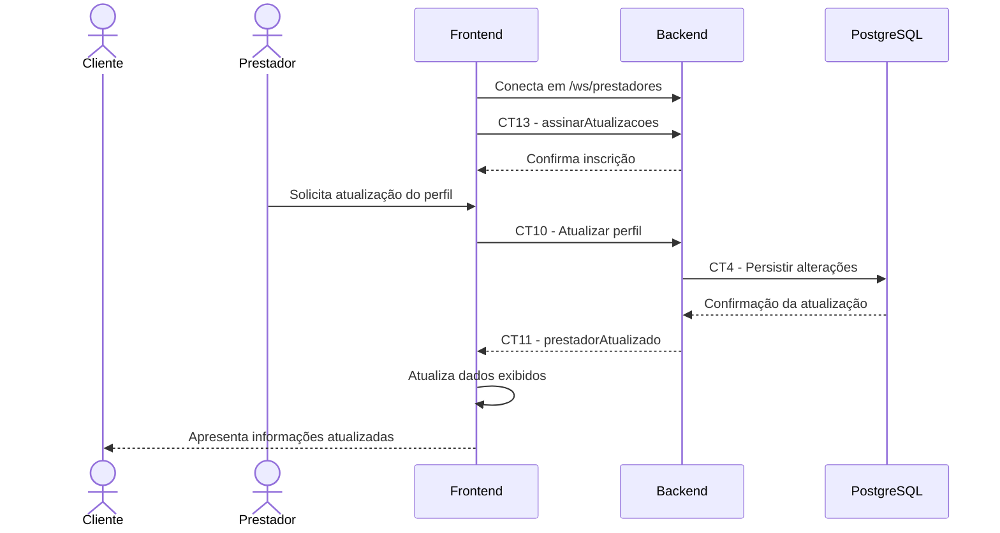

# E10 — Comunicação em tempo real

## 1. Objetivo

Permitir que o frontend receba notificações em tempo real quando houver atualizações relevantes nos perfis dos prestadores, utilizando WebSocket.

## 2. Atores

- Cliente
- Frontend
- Backend
- Banco de dados PostgreSQL
- Prestador

## 3. Pré-condições

- A aplicação frontend está acessível.
- O canal WebSocket está disponível.
- O frontend pode informar os critérios de interesse, como categoria e localização.

## 4. Fluxo principal

1. O frontend estabelece uma conexão WebSocket com o backend pelo canal `/ws/prestadores`.
2. O frontend envia uma mensagem de inscrição conforme o contrato CT13.
3. A mensagem contém a categoria desejada e os filtros de localização aplicáveis.
4. O backend processa a inscrição e retorna a confirmação.
5. Um prestador atualiza seu perfil por meio do contrato CT10.
6. O backend valida a requisição e persiste as alterações conforme o contrato CT4.
7. O backend emite o evento `prestadorAtualizado` conforme o contrato CT11.
8. O frontend recebe o evento e identifica os dados atualizados.
9. O frontend atualiza as informações pertinentes apresentadas ao cliente.

## 5. Pós-condições

- O frontend fica inscrito para receber atualizações conforme os critérios informados.
- As atualizações relevantes podem ser comunicadas sem que o cliente precise realizar uma nova pesquisa a cada alteração.
- A interface pode refletir as informações recebidas pelo WebSocket.

## 6. Contratos envolvidos

- CT13 — Assinar atualizações.
- CT10 — Atualizar perfil de prestador.
- CT4 — Persistência de perfil de prestador.
- CT11 — Evento de prestador atualizado.
- CT5 — Pesquisar prestadores, como alternativa para atualizar os resultados após uma falha de conexão.

## 7. Fluxos de exceção

- WebSocket indisponível: o frontend informa que a comunicação em tempo real não está disponível.
- Inscrição inválida: o backend informa que os parâmetros necessários não foram fornecidos corretamente.
- Conexão perdida: o frontend pode tentar restabelecer a conexão conforme a implementação adotada.
- Falha na comunicação em tempo real: o frontend pode realizar uma nova pesquisa utilizando CT5 para obter os dados atuais.

## 8. Diagrama de sequência

## 9. Recuperação após falhas

Caso a comunicação WebSocket não esteja disponível, o frontend pode recorrer ao contrato CT5 para realizar uma nova pesquisa e obter os resultados atualizados.

A estratégia de reconexão e a frequência de novas pesquisas devem seguir a implementação definida pelo grupo.
