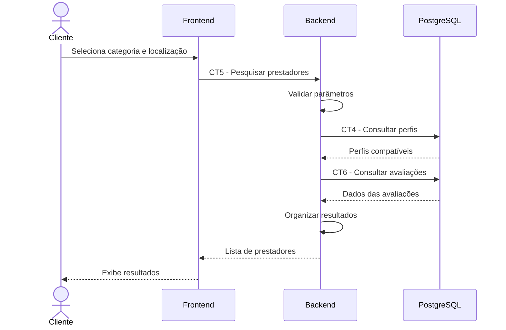

# E3 — Pesquisa de prestadores

## 1. Objetivo

Permitir que o cliente encontre prestadores de serviços de acordo com uma categoria e uma localização.

## 2. Atores

- Cliente
- Frontend
- Backend
- Banco de dados PostgreSQL

## 3. Pré-condições

- O cliente acessa a funcionalidade de pesquisa.
- Uma categoria de serviço é informada.
- A localização é fornecida conforme uma das modalidades previstas: cidade e UF ou coordenadas geográficas.

## 4. Fluxo principal

1. O cliente seleciona a categoria de serviço desejada.
2. O cliente informa a localização por cidade e UF ou utiliza coordenadas geográficas, conforme a modalidade de pesquisa.
3. O frontend envia os parâmetros de pesquisa ao backend por meio do contrato CT5.
4. O backend valida os parâmetros recebidos.
5. O backend consulta os perfis profissionais conforme o contrato CT4.
6. O backend utiliza as informações de avaliações conforme o contrato CT6 para obter a média quando disponível.
7. O backend organiza os resultados compatíveis com os critérios da pesquisa.
8. O backend retorna a lista de prestadores encontrados.
9. O frontend apresenta os resultados ao cliente.

## 5. Pós-condições

- A lista de prestadores compatíveis é apresentada ao cliente.
- Caso nenhum prestador seja encontrado, o frontend pode apresentar um estado vazio.

## 6. Contratos envolvidos

- CT5 — Pesquisar prestadores.
- CT4 — Persistência de perfil de prestador.
- CT6 — Persistência de avaliação.

## 7. Fluxos de exceção

- Categoria não informada: a pesquisa não pode ser executada corretamente.
- Localização ausente ou inválida: o backend informa o problema conforme as regras da modalidade de pesquisa.
- Coordenadas inconsistentes: o backend retorna um erro de validação.
- Nenhum prestador encontrado: o backend retorna uma lista vazia, sem tratar a situação como erro de servidor.
- Erro de comunicação: o frontend informa que não foi possível carregar os resultados.

## 8. Observações

A especificação prevê pesquisa por cidade e UF ou por coordenadas geográficas. O algoritmo de proximidade deve seguir a decisão técnica adotada pelo grupo, sem presumir uma fórmula ou distância máxima que não tenha sido definida.

## 9. Diagrama de sequência

