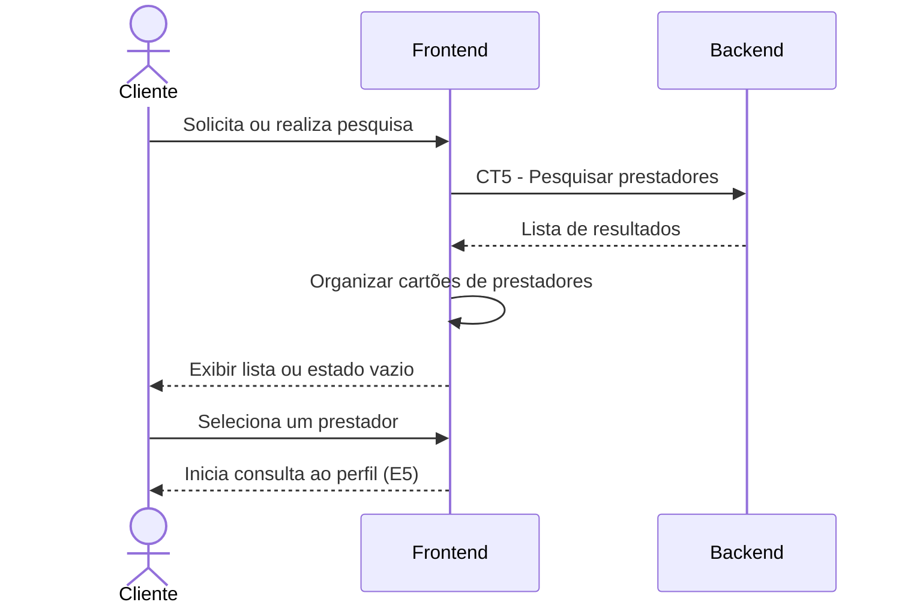

# E4 — Exibição da lista de prestadores

## 1. Objetivo

Apresentar ao cliente os prestadores encontrados na pesquisa, facilitando a comparação das informações disponíveis.

## 2. Atores

- Cliente
- Frontend
- Backend

## 3. Pré-condições

- O cliente realizou uma pesquisa de prestadores.
- O frontend recebeu a resposta da pesquisa ou identificou que não existem resultados.

## 4. Fluxo principal

1. O frontend recebe os resultados da pesquisa realizada por meio do contrato CT5.
2. O frontend interpreta os dados retornados pelo backend.
3. Para cada prestador, o frontend apresenta as informações disponíveis, como nome profissional, categoria, região de atendimento, avaliação média e valor de referência.
4. O cliente visualiza a lista de prestadores.
5. O cliente pode selecionar um prestador para consultar seu perfil, conforme o fluxo E5.

## 5. Pós-condições

- A lista de prestadores é exibida ao cliente.
- Quando não existem resultados, o frontend apresenta uma mensagem informativa.
- O cliente pode selecionar um prestador para consultar mais informações.

## 6. Contratos envolvidos

- CT5 — Pesquisar prestadores.
- CT4 — Persistência de perfil de prestador.
- CT6 — Persistência de avaliação.

Os contratos CT4 e CT6 são utilizados pelo backend para compor os resultados da pesquisa. O frontend recebe a resposta por meio do CT5.

## 7. Fluxos de exceção

- Lista vazia: o frontend informa que nenhum prestador foi encontrado.
- Falha na requisição: o frontend informa que não foi possível carregar os resultados.
- Informação opcional ausente: o frontend apresenta somente os dados disponíveis, sem inventar valores.

## 8. Diagrama de sequência

