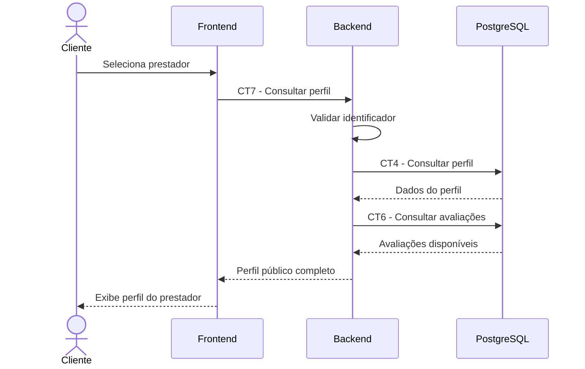

# E5 — Consulta ao perfil do prestador

## 1. Objetivo

Permitir que o cliente consulte as informações públicas de um prestador para conhecer seus serviços, regiões atendidas, preço de referência e avaliações.

## 2. Atores

- Cliente
- Frontend
- Backend
- Banco de dados PostgreSQL

## 3. Pré-condições

- O cliente selecionou um prestador na lista ou acessou seu identificador.
- O identificador do prestador está disponível para a consulta.

## 4. Fluxo principal

1. O cliente seleciona um prestador.
2. O frontend solicita o perfil por meio do contrato CT7, informando o identificador do prestador.
3. O backend valida o identificador recebido.
4. O backend consulta os dados do perfil conforme o contrato CT4.
5. O backend consulta as avaliações disponíveis conforme o contrato CT6.
6. O backend organiza as informações públicas do prestador.
7. O backend retorna o perfil ao frontend.
8. O frontend apresenta os dados do prestador ao cliente.

## 5. Pós-condições

- O perfil público do prestador é apresentado.
- O cliente pode consultar as informações disponíveis e decidir se deseja entrar em contato.

## 6. Contratos envolvidos

- CT7 — Consultar perfil de prestador.
- CT4 — Persistência de perfil de prestador.
- CT6 — Persistência de avaliação.

## 7. Fluxos de exceção

- Identificador inválido: o backend retorna um erro informando que o identificador não é válido.
- Prestador inexistente: o backend retorna o erro de prestador não encontrado.
- Falha na comunicação: o frontend informa que não foi possível carregar o perfil.

## 8. Diagrama de sequência

