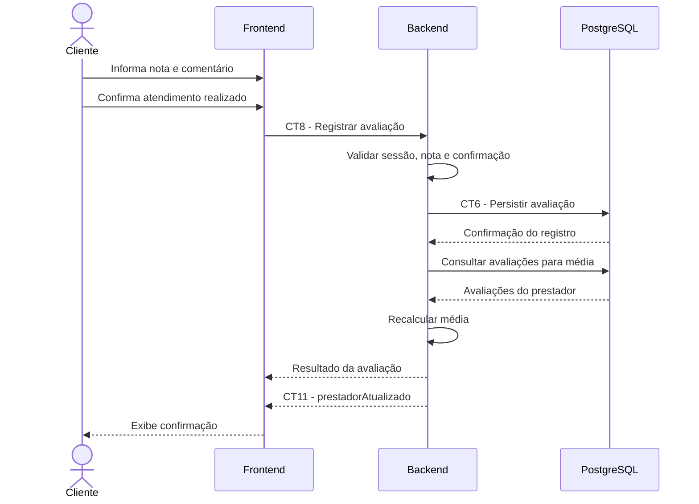

# E6 — Avaliação de prestador

## 1. Objetivo

Permitir que um cliente registre uma avaliação de um prestador após confirmar que o atendimento foi realizado.

## 2. Atores

- Cliente
- Frontend
- Backend
- Banco de dados PostgreSQL

## 3. Pré-condições

- O cliente está autenticado.
- O prestador existe no sistema.
- O cliente confirma que o atendimento foi realizado.

## 4. Fluxo principal

1. O cliente acessa a funcionalidade de avaliação do prestador.
2. O cliente seleciona uma nota entre 1 e 5.
3. Opcionalmente, o cliente informa um comentário.
4. O cliente confirma que o atendimento foi realizado.
5. O frontend envia os dados da avaliação ao backend por meio do contrato CT8.
6. O backend valida a autenticação, a nota informada e a confirmação do atendimento.
7. O backend registra a avaliação conforme o contrato CT6.
8. O backend recalcula a média de avaliações do prestador.
9. O backend emite o evento de atualização conforme o contrato CT11.
10. O backend retorna o resultado da operação ao frontend.
11. O frontend apresenta a confirmação da avaliação ao cliente.

## 5. Pós-condições

- A avaliação fica registrada no sistema.
- A média de avaliações do prestador é atualizada.
- O evento de atualização pode informar os clientes inscritos sobre a alteração.

## 6. Contratos envolvidos

- CT14 — Autenticar usuário.
- CT2 — Persistência de usuário.
- CT8 — Registrar avaliação.
- CT6 — Persistência de avaliação.
- CT11 — Evento de prestador atualizado.

## 7. Fluxos de exceção

- Usuário não autenticado: o backend impede o registro da avaliação.
- Nota inválida: o backend rejeita valores fora do intervalo permitido de 1 a 5.
- Atendimento não confirmado: o backend não registra a avaliação.
- Prestador inexistente: o backend retorna um erro de prestador não encontrado.
- Falha de persistência: o sistema informa que não foi possível concluir a operação.

## 8. Observações

A confirmação de atendimento é uma declaração do cliente. A especificação não define um mecanismo externo para verificar se o serviço foi efetivamente realizado.

## 9. Diagrama de sequência

