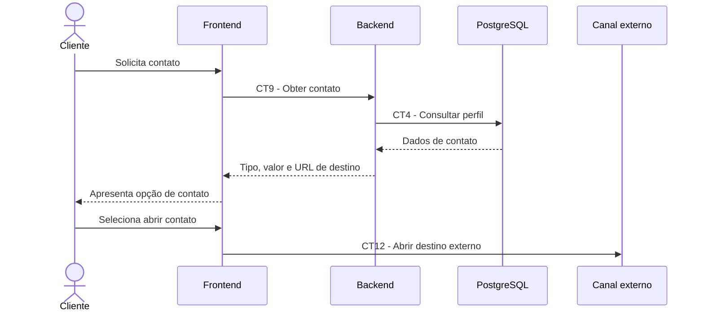

# E7 — Contato com prestador

## 1. Objetivo

Permitir que o cliente obtenha os dados de contato de um prestador e acesse o canal externo disponibilizado em seu perfil.

## 2. Atores

- Cliente
- Frontend
- Backend
- Canal externo de contato

## 3. Pré-condições

- O cliente acessou o perfil de um prestador.
- O prestador possui informações de contato cadastradas.

## 4. Fluxo principal

1. O cliente seleciona a opção de contato no perfil do prestador.
2. O frontend solicita os dados de contato por meio do contrato CT9.
3. O backend consulta as informações de contato armazenadas conforme o contrato CT4.
4. O backend retorna o tipo de contato, o valor cadastrado e a URL de destino, quando disponível.
5. O frontend apresenta ou utiliza as informações recebidas.
6. O cliente seleciona a opção para abrir o canal de contato.
7. O frontend utiliza o contrato CT12 para abrir o destino externo.

## 5. Pós-condições

- O cliente é direcionado ao canal externo de contato disponibilizado pelo prestador, quando o destino estiver válido e acessível.

## 6. Contratos envolvidos

- CT9 — Obter contato de prestador.
- CT4 — Persistência de perfil de prestador.
- CT12 — Abrir contato externo.

## 7. Fluxos de exceção

- Prestador inexistente: o backend informa que o prestador não foi encontrado.
- Contato indisponível: o sistema informa que não há um canal de contato disponível.
- URI inválida: o frontend não deve tentar abrir um destino inválido.
- Falha ao abrir o destino: o sistema informa que não foi possível acessar o canal externo.

## 8. Limitações

O contato ocorre fora do QuemResolve. Este fluxo não prevê mensagens internas nem a realização da contratação diretamente pela aplicação.

## 9. Diagrama de sequência

