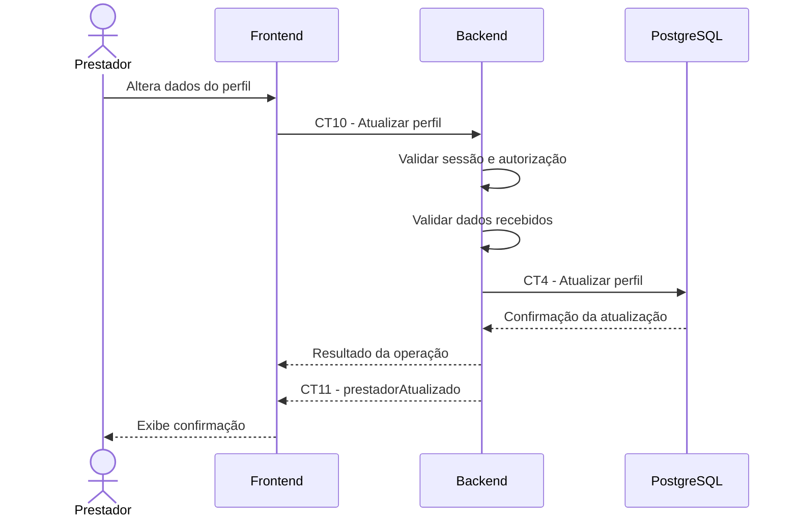

# E8 — Atualização do perfil do prestador

## 1. Objetivo

Permitir que um prestador autenticado altere as informações do seu perfil profissional.

## 2. Atores

- Prestador
- Frontend
- Backend
- Banco de dados PostgreSQL

## 3. Pré-condições

- O prestador possui uma conta cadastrada.
- O prestador está autenticado.
- O perfil profissional existe no sistema.

## 4. Fluxo principal

1. O prestador acessa a área de edição do perfil.
2. O frontend apresenta os dados atuais do perfil.
3. O prestador altera os campos desejados.
4. O frontend envia as alterações ao backend por meio do contrato CT10.
5. O backend valida a autenticação e a autorização do usuário.
6. O backend valida os campos recebidos.
7. O backend atualiza os dados persistidos conforme o contrato CT4.
8. O backend retorna a confirmação da atualização.
9. O backend emite o evento CT11 para comunicar a atualização do perfil.
10. O frontend apresenta a confirmação ao prestador.

## 5. Pós-condições

- O perfil do prestador fica atualizado.
- A data de atualização é registrada.
- O evento de atualização é emitido para os clientes inscritos, conforme as regras de comunicação em tempo real.

## 6. Contratos envolvidos

- CT14 — Autenticar usuário.
- CT2 — Persistência de usuário.
- CT10 — Atualizar perfil de prestador.
- CT4 — Persistência de perfil de prestador.
- CT11 — Evento de prestador atualizado.

## 7. Fluxos de exceção

- Usuário não autenticado: o backend rejeita a requisição.
- Acesso negado: o usuário não pode alterar o perfil solicitado.
- Prestador inexistente: o backend informa que o perfil não foi encontrado.
- Dados inválidos: o backend rejeita as alterações.
- Falha de persistência: o sistema informa que não foi possível concluir a atualização.

## 8. Diagrama de sequência

