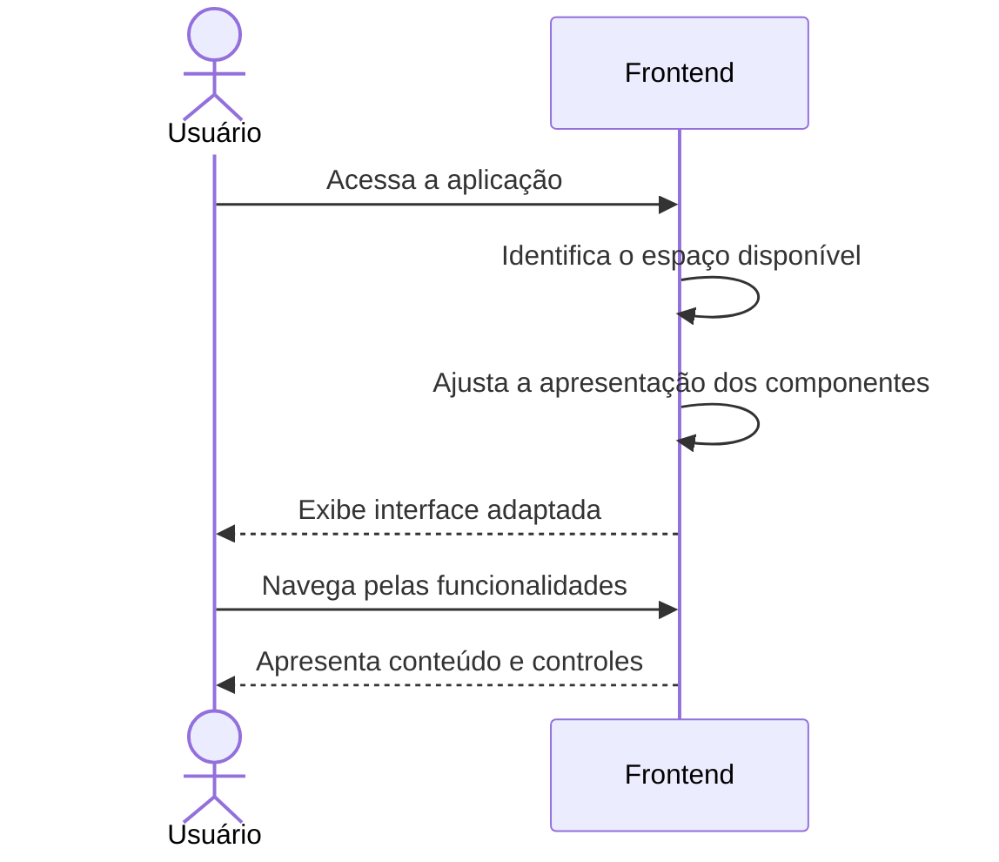

# E9 — Interface web responsiva

## 1. Objetivo

Garantir que a interface web do QuemResolve possa ser utilizada em diferentes tamanhos de tela, mantendo a acessibilidade às funcionalidades da aplicação.

## 2. Atores

- Usuário
- Frontend

## 3. Pré-condições

- O usuário acessa a aplicação por um navegador compatível.
- A aplicação frontend está disponível.

## 4. Fluxo principal

1. O usuário acessa a aplicação.
2. O frontend identifica o espaço disponível para a apresentação da interface.
3. Os componentes da interface se adaptam ao tamanho da tela.
4. O usuário navega pelas funcionalidades disponíveis.
5. O usuário consegue visualizar e utilizar formulários, resultados de pesquisa, perfis de prestadores e opções de contato.
6. O frontend mantém a organização e a legibilidade dos elementos durante a navegação.

## 5. Pós-condições

- A interface permanece utilizável em diferentes tamanhos de tela.
- As funcionalidades principais continuam acessíveis.
- As informações são apresentadas de maneira organizada e legível.

## 6. Contratos envolvidos

Este fluxo não possui um contrato técnico exclusivo.

Os contratos dos demais fluxos são utilizados quando a interface precisa consultar ou enviar dados ao backend.

## 7. Fluxos de exceção

- Problemas de renderização: alguns componentes podem não ser exibidos corretamente.
- Falha de comunicação com o backend: as funcionalidades que dependem de dados externos podem apresentar mensagens de erro.
- Espaço de tela insuficiente: a interface deve reorganizar os componentes para manter a usabilidade.

## 8. Critérios de responsividade

- Os componentes devem se adaptar a diferentes larguras de tela.
- Os textos devem permanecer legíveis.
- Os formulários devem permitir o preenchimento dos campos.
- Os cartões de prestadores devem permanecer compreensíveis.
- Os botões e demais controles devem continuar acessíveis.
- A navegação deve permanecer utilizável em telas menores.

## 9. Diagrama de sequência

